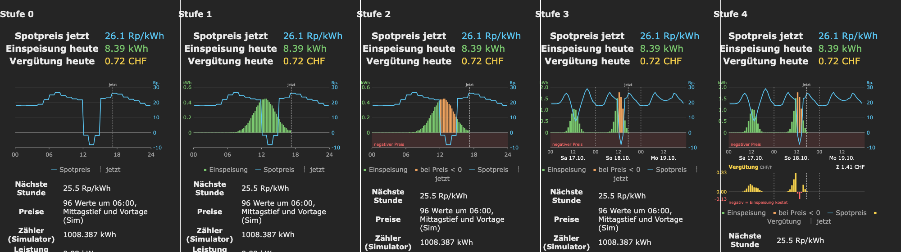

# gPlug Spotpreis-App (Tasmota Berry)



*Vom Starter (links, nur Spotpreis) zur Referenz-App (rechts): Einspeisung, Negativpreise, 3 Tage,
Vergütung. Am Workshop baust du diese Schritte mit dem Coding-Agenten.*

Unterlagen für den DIY-Workshop **«Arbeiten mit einem Coding-Agenten auf einem Embedded-Gerät»**
(12. November 2026, Glue, Bern). Stand der Unterlagen: Datei `VERSION`. Die Berry-App für den [gPlug](https://gplug.ch) holt die
dynamischen BKW-Einspeisetarife, misst die eingespeiste Energie und zeigt beides als Chart in der
Tasmota-WebUI.

## Mitbringen

Eigener gPlug ([gplug.ch](https://gplug.ch)), Notebook (macOS, Linux, Windows mit Ubuntu in WSL) mit Netzteil,
USB-Datenkabel. Installiert: [Docker Desktop](https://docs.docker.com/get-started/get-docker/)
und ein Texteditor. Sonst keine Vorbereitung nötig.

## Vor Ort einrichten

Schritt für Schritt mit erwarteter Ausgabe: [`RUNBOOK.md`](RUNBOOK.md). Kurzfassung:

1. Workshop-Ordner als ZIP holen, `./docker-run.sh` starten. Lädt
   beim ersten Mal das fertige Image und startet den Agenten opencode. Zugang zum Sprachmodell
   ist eingebaut.
2. gPlug ins Workshop-WLAN, `http://<gplug-ip>` öffnen. Helfer prüfen Firmware und Zeitzone.
3. IP eintragen und Starter laden:
   ```sh
   echo <gplug-ip> > .gplug
   ./upload.sh app/spot.be app/autoexec.be
   ./log.sh                                  # erwartet: SPOT: v0.3 geladen, keine BRY:-Zeile
   ```
   Die WebUI zeigt jetzt die Preislinie (Simulator, kein Smart Meter nötig).

Befehle für Linux, macOS und Ubuntu in WSL. Windows nur mit PowerShell:
[`WINDOWS_POWERSHELL.md`](WINDOWS_POWERSHELL.md).

## Übung (60 min)

Ablauf, Prompts und Prüfschritte: [`EXERCISES.md`](EXERCISES.md) ([PDF, A4](docs/EXERCISES.pdf)).

1. Energie-Balken mit kWh-Achse — **Pflicht**
2. Negativpreis: Balken orange, Bereich unter 0 schattiert — **Pflicht**
3. 3 Tage mit Stundenwerten — für Schnelle
4. Vergütungs-Chart mit Σ — für Schnelle

Hängen geblieben: Checkpoint des vorigen Schritts `app/steps/spot_N.be` nach `app/spot.be`
kopieren.

## Nach dem Workshop

- gPlug zurück ins Heim-WLAN.
- Am Smart Meter: in `app/spot.be` `"sim": false` setzen und `./upload.sh app/spot.be`.
- Weiterarbeiten mit eigenem Zugang zum Sprachmodell: [`SETUP_OPENCODE.md`](SETUP_OPENCODE.md),
  Image lokal bauen mit `./docker-run.sh --build`.

## Wichtige Dateien

- `app/spot.be` – die App, an der du arbeitest. `app/steps/` – Checkpoints nach jedem Schritt.
- `upload.sh`, `brcmd.sh`, `log.sh` – Gerät bedienen (hochladen, Berry-Befehl, Konsole).
- `AGENTS.md` – Regeln für den Coding-Agenten (liest opencode automatisch).
- `LEGENDE.md` – Begriffe und Abkürzungen.
- `WINDOWS_POWERSHELL.md` – Abweichungen für Windows ohne Ubuntu.


## Lizenz

MIT, siehe `LICENSE`; Fremdes: `THIRD_PARTY.md`.
