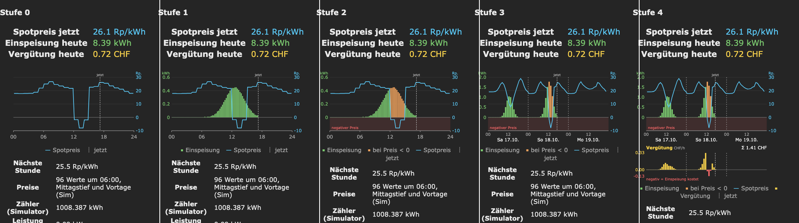

# gPlug Spotpreis-App (Tasmota Berry)

*Vom Starter (links, nur Spotpreis) zur Referenz-App (rechts): Einspeisung, Negativpreise, 3 Tage,
Vergütung. Am Workshop baust du diese Schritte mit dem Coding-Agenten.*

Unterlagen für den DIY-Workshop **«Arbeiten mit einem Coding-Agenten auf einem Embedded-Gerät»**.
Stand der Unterlagen: Datei `VERSION`. Die Berry-App für den [gPlug](https://gplug.ch) holt die
dynamischen BKW-Einspeisetarife, misst die eingespeiste Energie und zeigt beides als Chart in der
Tasmota-WebUI.

## Programm

Ablauf pro Durchführung im Ordner [`workshop-instances/`](workshop-instances/):

- [Do 14.01.2027, 17:00–20:00](workshop-instances/2027-01-14.md)

## Mitbringen

Eigener gPlug ([gplug.ch](https://gplug.ch)), Notebook (Windows, macOS oder Linux) mit Netzteil,
USB-Datenkabel. Installiert: [Docker Desktop](https://docs.docker.com/get-started/get-docker/)
(Linux auch Docker Engine) und ein Texteditor. Sonst keine Vorbereitung nötig.

## Einführung

Folien zur Einführung: <https://gplug-ch.github.io/ki-workshop/slides/>

## Vor Ort einrichten (40 min)

Ein Runbook pro System, Schritt für Schritt mit erwarteter Ausgabe. Übersicht:
[`RUNBOOK.md`](RUNBOOK.md).

| Notebook | Runbook | Terminal |
|---|---|---|
| Windows | [`RUNBOOK_WINDOWS.md`](RUNBOOK_WINDOWS.md) | Ubuntu in WSL (empfohlen) oder PowerShell |
| macOS | [`RUNBOOK_MACOS.md`](RUNBOOK_MACOS.md) | Terminal |
| Linux | [`RUNBOOK_LINUX.md`](RUNBOOK_LINUX.md) | beliebig; Einfügen mit Ctrl+Shift+V |

Danach läuft der Agent opencode im Docker-Container (Zugang zum Sprachmodell eingebaut, gilt nur
am Workshop-Tag), der gPlug ist im Workshop-WLAN und zeigt den Starter: die Preislinie eines Tages
(Simulator, kein Smart Meter nötig).

## Übung (65 min)

Ablauf, Prompts und Prüfschritte: [`EXERCISES.md`](EXERCISES.md) ([PDF, A4](docs/EXERCISES.pdf)).

| Teil | Schritt | Für wen |
|---|---|---|
| A, von Hand | 0 Hello World: `app/hello.be` über die WebUI hochladen und starten (vor dem Starter, Runbook Schritt 6) | alle |
| B, mit opencode | 0 Hello World: vom Ein-Satz-Prompt zum vollständigen Prompt, der Agent schreibt `app/hello_agent.be` | alle |
| | 1 Energie-Balken mit kWh-Achse | Pflicht |
| | 2 Negativpreis: Balken orange, Bereich unter 0 schattiert | Pflicht |
| | 3 3 Tage mit Stundenwerten | optional, für Schnelle |
| | 4 Vergütungs-Chart mit Σ | optional, für Schnelle |
| | 5 2 Tage mit Viertelstunden | optional, für Fortgeschrittene |

Hängen geblieben: Checkpoint des vorigen Schritts `app/steps/spot_N.be` nach `app/spot.be`
kopieren.

## Nach dem Workshop

- gPlug zurück ins Heim-WLAN, am Smart Meter Simulator ausschalten: Runbook deines Systems,
  Abschnitt *Nach dem Workshop*.
- Weiterarbeiten mit eigenem Zugang zum Sprachmodell: [`SETUP_OPENCODE.md`](SETUP_OPENCODE.md).
- Weiterarbeiten ohne KI, nur mit Texteditor und Upload von Hand:
  [`SETUP_OHNE_KI.md`](SETUP_OHNE_KI.md).

## Lizenz

MIT, siehe `LICENSE`.
